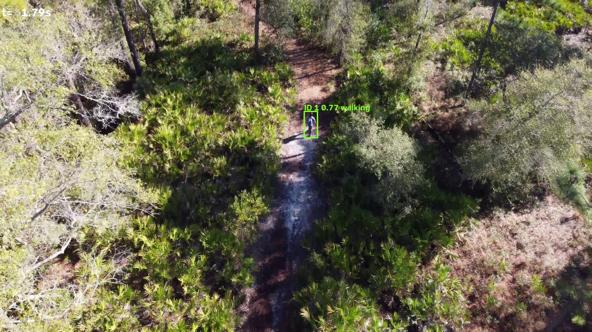
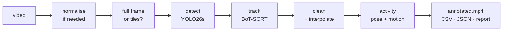

# grassdet: finding and tracking people hidden in vegetation

Detects, tracks and describes the activity of people in video who are partly hidden by grass, scrub
or forest, including people **lying, crouching or crawling**. Give it a clip; it returns an annotated
video, per-person tracks with activity labels, and a quality report that says when the footage is outside
what the model can handle.


<sub>grass_v1 on a 4K drone clip (stock footage, Pexels): the person is found in tiled-inference mode and labelled `walking`.</sub>

- **Detector:** YOLO26s fine-tuned on a light mix of forest, thermal and drone datasets
  (`grass_v1`, trained on a 4 GB laptop GPU in 3.4 h).
- **Tracker:** BoT-SORT with camera-motion compensation, tuned for slow, frequently hidden people; gaps
  of up to 4 s bridged and flagged.
- **Activity:** pose model + camera-compensated motion → `crawling`, `prone_still`, `crouching`,
  `walking`, `standing`.
- **Robust to unknown footage:** any resolution (automatic tiling for small people and 4K), odd codecs,
  variable frame rate, rotation, corrupt frames, GPU out-of-memory; every clip gets a report, even on failure.

## Results at a glance

Fine-tuning vs. the stock COCO model on the **ForestPersons test split** (people in forest, by how much of
the person is visible):

| Recall | 20 % visible | 40 % | 70 % | 100 % | lying | sitting | standing |
|---|---|---|---|---|---|---|---|
| Stock YOLO26s | 0.15 | 0.23 | 0.52 | 0.76 | 0.19 | 0.47 | 0.84 |
| **grass_v1** | **0.46** | **0.68** | **0.90** | **0.97** | **0.81** | **0.84** | **0.92** |

| | Stock | grass_v1 |
|---|---|---|
| ForestPersons test mAP50 | 0.748 | **0.918** |
| HIT-UAV thermal test mAP50 | 0.084 | **0.904** |
| Tracking IDF1, synthetic grass scenes A / B | 0.70 / 0.76 | **0.82 / 0.91** (0 ID switches) |

Honest caveats: the gain costs more false positives (0.07 → 0.29 per image); on a fast-moving 4K drone
clip one hiker was split into three IDs; a top-down white-hot thermal clip was missed (and flagged by the
QC report); crawling is not validated on real footage because no public dataset contains it.
Full analysis: **[docs/RESULTS.md](docs/RESULTS.md)**.

## Built under real constraints

- **A generalised model, not a use-case-specific one.** No footage or requirements were available from
  the client, so `grass_v1` is trained to cope with many conditions (ground and drone viewpoints, colour and
  thermal, tiny to full-frame people, 20–100 % visible) rather than tuned to one. Performance on a specific
  deployment would increase by fine-tuning on footage from that use case; the tooling for it is included.
- **No cloud compute.** All data preparation, training (3.4 h) and evaluation ran locally on a laptop with an
  RTX 3050 (4 GB VRAM), 16 GB RAM and ~22 GB of free disk. The dataset mix, image size and batch size are
  sized for that machine.

Challenges met, how they were solved, and the shortcomings that remain:
**[docs/CHALLENGES.md](docs/CHALLENGES.md)**.

## How it works



Details and design decisions (including why TAPNext was evaluated but not adopted):
**[docs/ARCHITECTURE.md](docs/ARCHITECTURE.md)**.

## Quick start

Requirements: Python 3.10+ (developed on 3.11, Windows 11), an NVIDIA GPU with CUDA (CPU works, slowly), `ffmpeg` on PATH
(optional, used only to normalise unusual clips).

```bash
git clone https://github.com/angelopchery/forestpersondetection.git
cd forestpersondetection
python -m venv .venv
# Windows: .venv\Scripts\activate    Linux/macOS: source .venv/bin/activate
pip install torch torchvision --index-url https://download.pytorch.org/whl/cu128   # pick your CUDA build
pip install -e .

python scripts/download_models.py yolo26s.pt yolo11s-pose.pt    # stock detector + pose model
# Fine-tuned detector: download grass_v1.pt from the GitHub Releases page into models/
```

Run it:

```bash
python scripts/run_pipeline.py --video path/to/clip.mp4          # one clip
python scripts/run_pipeline.py --video path/to/folder/           # every video in a folder
```

Results go to `outputs/<clip name>/`:

| File | Content |
|---|---|
| `annotated.mp4` | Boxes, IDs, confidence and activity per frame; thin boxes = gap bridged by interpolation |
| `detections.csv` | One row per person per frame: time, box, confidence, interpolated flag, posture, activity |
| `tracks.json` | One entry per person: first/last seen, duration, mean confidence, size, dominant activity, seconds crawling |
| `report.json` | Status (`ok` / `failed` + traceback), warnings, inference mode, timings, real-time factor, GPU memory, config used |

Common adjustments (any config key can be overridden with `--set section.key=value`):

```bash
--set inference.mode=sliced                     # force tiling (tiny or distant people)
--set model.conf=0.15 postprocess.min_mean_conf=0.35   # fewer false alarms
--set behavior.enabled=false                    # skip activity analysis (faster)
--set model.weights=models/yolo26s.pt           # compare against the stock model
--set tracker.config=configs/trackers/grass_ocsort.yaml   # alternative tracker
```

Speed on an RTX 3050 Laptop (4 GB): 1080p ≈ 17–19 fps detection + tracking (about 3× real time end to end
with activity and rendering); 4K uses tiling at ≈ 2.6 fps.

## Training and evaluation

```bash
# data (Hugging Face login + accepted ForestPersons terms required)
python scripts/fetch_datasets.py --only forestpersons hit_uav uav_lowalt visdrone --delete-raw
python scripts/subset_dataset.py visdrone visdrone_lite --fraction 0.25
python scripts/dedupe_datasets.py --datasets forestpersons hit_uav uav_lowalt visdrone_lite --cross-split-only --apply

# train (4 GB GPU recipe; re-run the same command to resume after an interruption)
python scripts/train.py --config configs/train_laptop.yaml --data forestpersons hit_uav uav_lowalt visdrone_lite \
    --name grass_v1 --allow-noncommercial --resume

# evaluate
python scripts/eval_visibility.py --weights models/grass_v1.pt               # recall by visibility and pose
python scripts/make_synthetic_clip.py                                        # synthetic scene + exact ground truth
python scripts/run_pipeline.py --video data/samples/synthetic_grass.mp4
python scripts/evaluate.py --gt data/samples/synthetic_grass_gt.txt --pred run=outputs/synthetic_grass/detections.csv
python -m pytest tests                                                       # unit tests
```

- **[docs/DATASETS.md](docs/DATASETS.md)**: what the model was trained on, why, licences, and the
  data-preparation rules (scene-level splits, cross-split de-duplication).
- **[docs/TRAINING.md](docs/TRAINING.md)**: the laptop recipe, augmentations, the actual run, how to
  reproduce it.
- **[docs/CHALLENGES.md](docs/CHALLENGES.md)**: constraints, problems solved along the way, remaining
  shortcomings and what would fix each.

## Repository layout

```
configs/
  pipeline.yaml              every inference setting (model, tiling, tracker, clean-up, activity, outputs)
  trackers/                  BoT-SORT (default) and OC-SORT configs tuned for occluded people
  train_laptop.yaml          training recipe for a 4 GB GPU (train.yaml: larger GPUs)
  datasets.yaml              training data manifest: sources, subsets, licences
src/grassdet/
  pipeline.py                orchestration; writes report.json even on failure
  video_io.py                probing, normalisation, tolerant reading, H.264 writing
  detect.py                  full-frame / tiled detection, tile-fragment merging, OOM fallback
  track.py                   adapter feeding any detections into Ultralytics trackers
  postprocess.py             flicker removal, gap interpolation
  behavior.py                posture (pose keypoints) + motion → activity
  report.py                  footage quality checks → warnings
  output.py                  CSV, JSON, annotated video
  augment.py                 training augmentations (grass occlusion, thermal, compression, blur, …)
  evaluate.py                MOT metrics + recall by person size and visibility
scripts/                     command-line entry points (run, train, fetch/prepare data, evaluate, benchmark)
tests/                       unit tests for the pure-logic parts
docs/                        architecture, datasets, training, results, challenges and shortcomings
```

`data/`, `models/`, `outputs/` and `runs/` are git-ignored.

## Licence and data notice

- **Code:** [AGPL-3.0](LICENSE), matching the Ultralytics dependency it builds on.
- **`grass_v1.pt` weights: research and demonstration use only.** They were trained partly on
  ForestPersons (CC BY-NC-SA 4.0, which also prohibits weapons and mass-surveillance use) and VisDrone
  (CC BY-NC-SA 3.0). A commercially usable model needs retraining on commercially licensed data only;
  see [ARCHITECTURE.md § Licensing](docs/ARCHITECTURE.md#licensing).

## Acknowledgements

ForestPersons (ETRI), HIT-UAV, the low-altitude UAV person dataset, VisDrone (AISKYEYE, Tianjin University),
Ultralytics YOLO and trackers, and Google DeepMind's TAPNet / TAPNext (evaluated).
