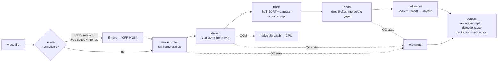

# Architecture

`grassdet` turns an uploaded video into tracked people, per-person activity and a quality report.
It is an offline, clip-by-clip pipeline: no streaming server, no database. Every stage is a plain Python
module under `src/grassdet/`, configured from one YAML file (`configs/pipeline.yaml`).

## Design principles

1. **Every clip gets a report, even on failure.** `process_clip` wraps the whole run; a corrupt file, a
   missing codec or a GPU crash produces `report.json` with `status: failed` and the traceback, never a
   silent gap.
2. **Unknown input, so measure instead of assume.** The client gave no camera, viewpoint or resolution.
   The pipeline probes each clip (codec, frame rate, rotation, person size) and adapts, and it states
   in the report when footage is outside what the model was trained for.
3. **Crawling is a behaviour, not a class.** The detector finds `person` in any pose; posture and motion
   are measured afterwards. A person who stands up, kneels or freezes is still found, and the behaviour
   stage works unchanged with any detector weights.
4. **Hard to start a track, easy to keep one.** Grass produces short false positives; real people are
   briefly hidden. Thresholds are asymmetric to match.
5. **Swappable parts behind narrow contracts.** Detector → `(N, 6)` array `x1, y1, x2, y2, conf, cls`;
   tracker → `(M, 6)` array `x1, y1, x2, y2, track_id, conf`. Anything that honours these can be dropped in.

## Stages

### 1. Video I/O — `video_io.py`
- `probe()` reads resolution, fps, frame count, codec and rotation (PyAV + ffprobe).
- `needs_normalize()` returns a reason or `None`. Re-encoding a 4K clip is expensive, so it only happens
  for variable frame rate, rotation metadata, codecs other than H.264/HEVC, or fps above `video.max_fps`
  (30; crawlers are slow, so 60 fps adds cost without information).
- `normalize()` → constant-frame-rate H.264 via ffmpeg, tolerant of decode errors. If ffmpeg is missing
  or fails, the original file is read directly and a warning is recorded.
- `FrameReader` skips isolated corrupt frames (up to 30 in a row) instead of ending the clip early;
  the count is reported.
- `VideoWriter` writes browser-playable H.264 through PyAV (OpenCV's default `mp4v` does not play in
  browsers).

### 2. Detection — `detect.py`
- **Model:** `models/grass_v1.pt`, YOLO26s fine-tuned to a single `person` class (see
  [TRAINING.md](TRAINING.md)). Inference at `imgsz` 1280, FP16 on GPU, `conf` 0.05 (low on purpose:
  the tracker's second pass needs low-score boxes).
- **Full frame vs sliced.** Small people vanish when a 4K frame is shrunk to 1280 px. Sliced mode cuts the
  frame into overlapping 640 px tiles (20 % overlap), runs them in batches, adds one full-frame pass for
  large people, and merges the results.
- **Merging tile fragments.** A person cut by a tile border yields two partial boxes that plain IoU-NMS
  cannot join. `merge_detections` merges on *intersection over the smaller box* (IoS ≥ 0.5), as SAHI's
  GREEDYNMM does.
- **Mode selection (`inference.mode: auto`).** Frames with a long side above 2200 px go straight to sliced.
  Smaller clips are *probed*: 8 sampled frames are run both ways; sliced wins if it finds clearly more
  confident people, or if the median person is shorter than 48 px. Resolution alone is a poor guide: a
  1080p drone clip can hold 15 px people.
- **Graceful degradation.** On CUDA out-of-memory the tile batch is halved, then inference falls back to
  CPU; each step is logged into the report.

### 3. Tracking — `track.py`, `configs/trackers/`
- A thin adapter feeds any `(N, 6)` detections into Ultralytics' tracker implementations (Ultralytics only
  supports its trackers through `model.track()`, which cannot be used with sliced inference).
- **Default: BoT-SORT** (`grass_botsort.yaml`), tuned for slow, frequently hidden people:

  | Setting | Value | Why |
  |---|---|---|
  | `new_track_thresh` | 0.6 | a new ID needs a confident detection (grass flicker rarely reaches it) |
  | `track_high_thresh` / `track_low_thresh` | 0.4 / 0.05 | ByteTrack-style second pass keeps half-hidden people attached to their track |
  | `track_buffer_seconds` | 4.0 | a lost track waits 4 s for its person; converted to frames per clip fps |
  | `gmc_method` | sparseOptFlow at ≤960 px | camera-motion compensation for handheld/drone clips, at a fraction of full-resolution cost |
  | `with_reid` | false | appearance is mostly grass texture; ReID added more confusion than it removed |

- **Alternative:** OC-SORT (`grass_ocsort.yaml`): better re-association after long occlusions, no camera
  compensation. Switch with `--set tracker.config=configs/trackers/grass_ocsort.yaml`.

### 4. Clean-up — `postprocess.py`
Offline, after the whole clip is tracked:
- drop tracks shorter than `min_track_seconds` (1.0 s) or with mean confidence below `min_mean_conf` (0.25);
- linearly interpolate gaps up to `max_interp_gap_seconds` (4.0 s), flagging every filled frame
  (`interpolated = 1` in the CSV, thin boxes in the video);
- renumber IDs 1..K in order of first appearance.

### 5. Behaviour — `behavior.py`
For each track, about 5 times per second:
1. **Posture** from a pose model (YOLO11s-pose) run on the padded track crop, resized to a fixed 320 px
   square (a fixed shape keeps the GPU fast; uniform scaling preserves angles). Torso angle between
   shoulder and hip midpoints: ≥ 60° horizontal, ≥ 35° crouched, else upright; a foreshortened torso
   (person crawling towards the camera) counts as crouched. When keypoints are unreliable, posture falls
   back to box shape.
2. **Motion** in body lengths per second, after removing global camera translation (phase correlation on
   320 px greyscale frames), so a still person in a panning shot is not "moving".
3. **Activity** = posture × motion: horizontal + moving → `crawling`, horizontal + still → `prone_still`,
   crouched → `crouching`, upright → `walking` / `standing`, otherwise `unknown`. A 1 s majority vote
   removes flicker.

Known limits: top-down (drone) views have no meaningful "upright", so posture is often `unknown` or
box-shape-based there; a person crawling straight at the camera can read as crouching.

### 6. Quality checks — `report.py`
Cheap image statistics are sampled every 15 frames and turned into explicit warnings:

| Warning | Trigger |
|---|---|
| greyscale / thermal footage | mean channel difference < 3 |
| low light | mean brightness < 50 / 255 |
| very small people | median track height < 20 px in full-frame mode (suggests `inference.mode=sliced`) |
| low model confidence | median track confidence < 0.4 |
| no people / only flicker | no tracks survived, with the count of discarded candidates |

### 7. Outputs — `output.py`
Written to `outputs/<clip name>/`:

| File | Content |
|---|---|
| `annotated.mp4` | Boxes, IDs, confidence and activity drawn per frame; thin boxes = interpolated |
| `detections.csv` | `frame, time_s, track_id, x1, y1, x2, y2, conf, interpolated, posture, activity` |
| `tracks.json` | Per person: start/end, duration, observed vs interpolated frames, mean confidence, median height, dominant activity, seconds per activity, crawling seconds |
| `report.json` | Status, warnings, input/processed video info, inference mode + probe, per-stage timings, inference fps, real-time factor, peak GPU memory, the full config used |

## Evaluation tooling

| Tool | Measures |
|---|---|
| `scripts/evaluate.py` + `grassdet/evaluate.py` | Tracking against MOT-format ground truth (e.g. CVAT export): IDF1, MOTA, ID switches, fragmentations, mostly tracked/lost, false positives per minute, recall by person size and by visibility. Several runs side by side. |
| `scripts/eval_visibility.py` | Detection recall on the ForestPersons test split by visibility (20/40/70/100 %) and pose (standing/sitting/lying) |
| `scripts/make_synthetic_clip.py` | Procedural grass scenes with walking/crawling people, occluding clumps, camera pan and exact ground truth: a regression test, not an accuracy claim |
| `scripts/benchmark.py` | Detector speed and GPU memory on the current machine |
| `tests/test_core.py` | Unit tests for posture rules, smoothing, interpolation, tiling, tile merging and the evaluator |

## Design decisions and alternatives considered

### Detector: YOLO26s
NMS-free, a loss aimed at small targets, 9.5 M parameters, fits training on a 4 GB laptop GPU at 768 px, and
plugs straight into the Ultralytics trackers. Out of the box it beat YOLO11s on the synthetic grass clip
(IDF1 0.70 vs 0.56, false positives per minute halved). RF-DETR (Apache-2.0) transfers better to new
domains and is licence-clean, but is 2–3× slower to train and needs a separate stack; it is the
upgrade path if AGPL becomes a blocker (see Licensing). Zero-shot detectors (OWLv2, Grounding DINO,
YOLOE) are too slow per frame and unproven on camouflaged people.

### TAPNext / TAPNext++ (Google DeepMind `tapnet`): evaluated, not adopted
TAPNext is a **point tracker**: given query points it returns their positions and a visible/occluded flag
in later frames. It does not detect people, so it cannot replace YOLO; "YOLO + TAPNext" means YOLO
finds people and TAPNext follows points on them. Measured on the RTX 3050 with the synthetic grass clip:

| | Result |
|---|---|
| VRAM | ~0.9 GB fp16 at 256×256: fits next to the detector |
| Speed | 120–190 ms/frame at 256 px (5–8 fps), 2–4× the cost of the whole current pipeline |
| Occlusion flag | Reliable when points are on a person |
| Points seeded on grass | Stay on grass and stay "visible": bad seeds are not self-detected |
| Re-acquisition after full occlusion | 1 of 2 people re-found |
| Small people | Internal 256 px input: a 30 px person in 1080p becomes ~7 px |

Our weakest point is recall when a person is mostly hidden, and a point tracker cannot fix that (there
are few pixels of the person left to track). Short gaps are already bridged by the tracker's motion model
and interpolation at no cost. The one plausible gain is re-linking an ID after a long gap. It is kept as
an optional experiment for that role, to be adopted only if `evaluate.py` shows fewer ID switches
without losing recall. CoTracker3 was excluded (non-commercial licence); SAM 2 / SAMURAI mask propagation
handles one object at a time and is heavy on 4 GB.

### Why not a dedicated "crawling" class
No public dataset labels crawling, a crawling class would miss the same person the moment they stop or
kneel, and it would tie behaviour to one set of weights. Posture + motion generalises and can be
validated separately.

## Licensing

- **Code dependencies:** Ultralytics (detector, trackers) is **AGPL-3.0**. Distributing this pipeline, or
  offering it as a network service, carries AGPL obligations unless an Ultralytics Enterprise licence is
  bought. The repository is therefore published under AGPL-3.0.
- **Trained weights (`grass_v1.pt`):** trained partly on ForestPersons (CC BY-NC-SA 4.0, plus a ban on
  weapons and mass-surveillance use) and VisDrone (CC BY-NC-SA 3.0). **Research and demonstration use
  only.** `train.py` refuses non-commercial data unless `--allow-noncommercial` is passed, and labels such
  runs research-only.
- **Commercial path:** retrain on the commercial-OK sources only (HIT-UAV, the low-altitude UAV set, plus
  sources marked commercial in [DATASETS.md](DATASETS.md)), and either license Ultralytics or swap in an
  Apache-2.0 detector behind `Detector.predict` and MIT ByteTrack/OC-SORT behind `Tracker.update`.

## Performance (RTX 3050 Laptop, 4 GB, on AC power)

| Input | Mode | Detection + tracking | Whole clip (incl. behaviour + rendering) |
|---|---|---|---|
| 1920×1080, 25 fps (synthetic) | full frame | 17–19 fps | ~3.0× real time |
| 1130×530, 30 fps (thermal drone) | full frame | 30.6 fps | 1.7× real time |
| 3840×2160, 24 fps (drone, stock) | sliced (auto) | 2.6 fps | 13× real time |

Peak GPU memory stayed under 250 MB in every case. Sliced 4K is the expensive path: 28 tiles per frame.
For near-real-time 4K, lower `inference.slice_size` overlap, raise `sliced_above_px`, or export the
detector to TensorRT FP16.
