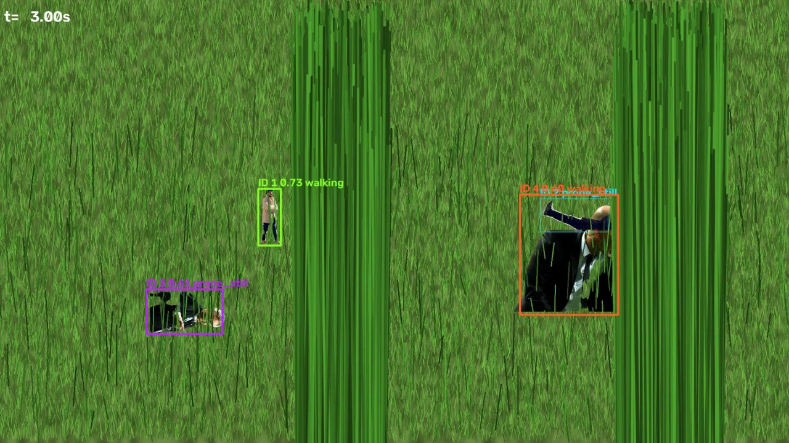
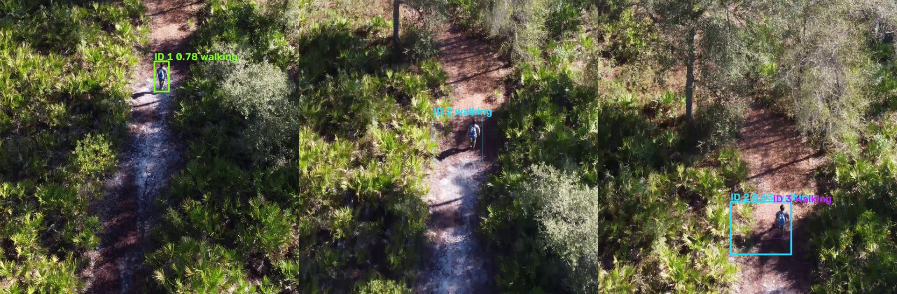

# Results and findings

All numbers below were produced on 2026-10-08 with the code in this repository, on an RTX 3050 Laptop GPU
(4 GB). "Stock" is the COCO-pretrained YOLO26s; "grass_v1" is the same model fine-tuned as described in
[TRAINING.md](TRAINING.md). Raw outputs are in `outputs/eval/` (git-ignored; re-create with the commands
at the end).

## Summary

| Question | Answer |
|---|---|
| Does fine-tuning help on partly hidden people? | Yes, a lot. ForestPersons test recall 0.63 → 0.84 (mAP50 0.75 → 0.92); recall on lying people 0.19 → 0.81. |
| Does it help tracking? | Yes, on the synthetic grass scenes: IDF1 0.70 → 0.82 and 0.76 → 0.91, no ID switches, small-person recall 0.14–0.24 → 0.99. |
| What does it cost? | More false positives at the detector level (0.07 → 0.29 per image at conf 0.25). On one of the two synthetic scenes this also raised track-level false positives. |
| Does it work on real footage? | On a 4K drone clip of a hiker in scrub forest: the person is detected in every frame, but the track splits into 3 IDs while the camera descends and turns. On a white-hot thermal drone clip with a HUD overlay: **it fails** (the QC report flags the clip correctly). |
| Is crawling recognised? | On synthetic clips, yes. On real crawling footage it is **unvalidated**: no public dataset contains crawling. |

## 1. Detection on public test splits

Same image size (768 px) for both models, single class `person`.

| Dataset / split | What it tests | Stock mAP50 | grass_v1 mAP50 | Stock recall | grass_v1 recall |
|---|---|---|---|---|---|
| ForestPersons / test (235 img) | people in forest, ground view, 20–100 % visible | 0.748 | **0.918** | 0.625 | **0.837** |
| HIT-UAV / test (205 img) | thermal drone, fields and roads | 0.084 | **0.904** | 0.364 | **0.828** |
| VisDrone / val (326 img) | tiny people, urban drone | 0.390 | **0.541** | 0.376 | **0.474** |
| Synthetic grass / val | pipeline regression scenes | 0.644 | **0.752** | 0.503 | **0.688** |

mAP50-95 (box tightness) rose less: ForestPersons 0.500 → 0.557, HIT-UAV 0.036 → 0.459, VisDrone 0.165 → 0.214.

## 2. Recall by visibility and pose (ForestPersons test)

The client's real question is "how hidden can someone be and still be found?". ForestPersons labels
every person with a visibility level and a pose, so this can be measured directly
(`scripts/eval_visibility.py`, confidence ≥ 0.25, IoU ≥ 0.5, 471 people).

| | 20 % visible (n=41) | 40 % (n=65) | 70 % (n=88) | 100 % (n=277) |
|---|---|---|---|---|
| Stock | 0.15 | 0.23 | 0.52 | 0.76 |
| **grass_v1** | **0.46** | **0.68** | **0.90** | **0.97** |

| | lying (n=59) | sitting (n=216) | standing (n=196) | false positives / image |
|---|---|---|---|---|
| Stock | 0.19 | 0.47 | 0.84 | 0.07 |
| **grass_v1** | **0.81** | **0.84** | **0.92** | 0.29 |

The gain is largest where it matters: lying and mostly hidden people. A person who is 70 % hidden is
found 9 times in 10 instead of half the time. Fully hidden people (ForestPersons' `unknown_0`) were
excluded from both training and evaluation.

## 3. Tracking on synthetic scenes (exact ground truth)

`scripts/make_synthetic_clip.py` composites walking and crawling people (cut-outs from Ultralytics'
sample images) into procedural grass with tall occluding clumps and a camera pan, with exact MOT ground
truth. Scored with `scripts/evaluate.py` (IoU ≥ 0.5, interpolated boxes included). These scenes are a
**regression test, not an accuracy claim**: real grass, light and people differ.



| Metric | Scene A: stock | Scene A: grass_v1 | Scene B: stock | Scene B: grass_v1 |
|---|---|---|---|---|
| IDF1 | 0.696 | **0.824** | 0.757 | **0.914** |
| MOTA | 0.564 | **0.673** | 0.569 | **0.839** |
| Recall | 0.595 | **0.764** | 0.671 | **0.853** |
| Precision | **0.951** | 0.893 | 0.868 | **0.984** |
| ID switches | 0 | 0 | 0 | 0 |
| Fragmentations | **0** | 12 | **0** | 1 |
| Mostly tracked / mostly lost | 1 / 1 | **2 / 0** | 2 / 0 | **3 / 0** |
| False positives / minute | **150** | 445 | 590 | **80** |
| Recall, small people (32–96 px) | 0.137 | **0.985** | 0.243 | **0.987** |
| Recall, heavily occluded (< 30 % visible) | 0.066 | **0.312** | 0.100 | 0.000 |
| Recall, partly occluded (30–70 %) | 0.403 | **0.751** | 0.276 | **0.693** |

Reading it: grass_v1 finds far more of the small and partly hidden people and never swaps identities.
Scene A shows the trade-off: more fragmentations (a track breaks and resumes, keeping its ID thanks to
interpolation) and more false-positive boxes per minute.

## 4. Real footage (stock clips, qualitative)

No labelled real footage of the target scenario exists, so two public stock clips were run through the
unchanged pipeline and inspected frame by frame. They are not part of this repository (licensing).

### 4.1 Drone, 4K, hiker on a trail through scrub forest (Pexels, 3840×2160, 24 fps, 5.3 s)



| | Observation |
|---|---|
| Inference mode | `auto` chose sliced (4K) |
| Detection | Person found in every frame, confidence 0.64–0.75 |
| Activity | `walking` throughout: correct |
| Tracking | **One person, three IDs** (0–2.8 s, 2.9–4.6 s, 4.2–5.2 s; IDs 2 and 3 overlap for 0.4 s) |
| Box quality | Some boxes are much larger than the person (tile-merge union) |
| Speed | 2.6 fps detection + tracking, 13× real time overall |

Cause: the camera descends and turns quickly, so the hiker's size and position change faster than the
motion model predicts, and the loose sliced-mode boxes lower the overlap further. Detection is not the
problem here; identity continuity is. Fix on the roadmap: post-hoc tracklet stitching (§6).

### 4.2 Thermal drone with HUD overlay (Shutterstock preview, 1130×530, 30 fps, 20 s)

White-hot thermal, top-down, 2–5 people, heavy HUD graphics, scan lines and a watermark.

| | Observation |
|---|---|
| Result | **0 tracks**: a miss. |
| QC report | Correctly warned: "Frames are effectively grayscale (thermal/IR/night-vision?) … review manually." |
| Why | The detector does fire (1,721 raw boxes), but grass_v1's best confidence per frame peaks around 0.49 (median 0.20), below the 0.6 needed to start a track. The stock model reaches ≥ 0.6 in 10 of 60 sampled frames, so fine-tuning **reduced** confidence on this kind of footage. |
| Lower thresholds? | Tested (`new_track_thresh` 0.3, `track_high_thresh` 0.25, `min_mean_conf` 0.15). This clip went from 0 to 5 tracks, but 2 of the 5 small people were still missed and the two large close-up people were never found. On the synthetic scenes the same thresholds cut IDF1 from 0.82 to 0.62 and raised false positives from 445 to 3,545 per minute. **Not a safe default.** |

Conclusion: top-down white-hot thermal is outside what the model learned (its thermal data is HIT-UAV only,
small people from higher altitude). This needs thermal training data, not threshold tuning (§6).

## 5. Speed (RTX 3050 Laptop, 4 GB, AC power)

| Input | Mode | Detection + tracking | Whole clip | Peak GPU memory |
|---|---|---|---|---|
| 1920×1080, 25 fps | full frame | 17–19 fps | 2.2–3.1× real time | < 100 MB |
| 1130×530, 30 fps | full frame | 30.6 fps | 1.7× real time | < 250 MB |
| 3840×2160, 24 fps | sliced | 2.6 fps | 13× real time | 221 MB |

"Whole clip" includes behaviour analysis and rendering the annotated video.

## 6. Limitations

`grass_v1` is a generalised model trained without any footage from the target use case, entirely on a
laptop; the constraints and the problems solved along the way are in [CHALLENGES.md](CHALLENGES.md).
Ranked by how likely they are to matter on the client's footage:

1. **No validation on footage of the target scenario.** All quantitative results are on public datasets or
   synthetic scenes. The first labelled client clip will move these numbers.
2. **Crawling is unvalidated on real people.** No public dataset contains crawling. The behaviour rule
   (horizontal torso + movement) works on synthetic clips; lying is the closest trained pose.
3. **Identity breaks under fast camera motion** (4K drone clip: 1 person → 3 IDs).
4. **Thermal / night footage:** fails on top-down white-hot thermal; only HIT-UAV thermal in training.
   ForestPersonsIR access is still pending.
5. **More false positives than the stock model** at the detector level; track filters absorb most, but
   not all (synthetic scene A).
6. **Research-only weights:** trained on non-commercial data (ForestPersons, VisDrone). See
   [ARCHITECTURE.md § Licensing](ARCHITECTURE.md#licensing).
7. **Sliced 4K is slow** (13× real time on this laptop).

## 7. Roadmap (by expected payoff)

| # | Step | Fixes | Effort |
|---|---|---|---|
| 1 | Label 5–10 real clips of people in grass (stock or staged) in CVAT, score with `evaluate.py`, tune `conf` / track thresholds on them | 1, 5 | ~3 h labelling with model pre-labels |
| 2 | Tracklet stitching in `postprocess.py`: join a track that ends with one that starts within ~1 s nearby with similar size | 3 | small code change; accept only if synthetic IDF1 does not drop |
| 3 | Thermal data: ForestPersonsIR (once access is granted), WiSARD / POP; add white-hot ↔ black-hot polarity inversion to the augmentations; retrain as grass_v2 (~3 h) | 4 | one training run |
| 4 | Copy-paste compositing of segmented lying/crouching people into person-free grass with foreground blades | 2, 5 | moderate |
| 5 | Validate the behaviour labels on real crawling clips; report crawling precision/recall | 2 | needs footage |
| 6 | TAPNext++ ID re-linking, adopted only if `evaluate.py` shows fewer fragmentations at equal recall | 3 | experiment |
| 7 | TensorRT FP16 export for the 3050; commercially clean retrain if the system is to be sold | 6, 7 | moderate |

## Reproduce

```powershell
python scripts/eval_visibility.py --weights models/yolo26s.pt --name baseline_yolo26s
python scripts/eval_visibility.py --weights models/grass_v1.pt --name grass_v1
python scripts/run_pipeline.py --video data/synthetic --out outputs/eval_tracking/yolo26s --set model.weights=models/yolo26s.pt output.render_video=false
python scripts/run_pipeline.py --video data/synthetic --out outputs/eval_tracking/grass_v1 --set output.render_video=false
python scripts/evaluate.py --gt data/synthetic/scene_a_gt.txt --pred yolo26s=outputs/eval_tracking/yolo26s/scene_a/detections.csv grass_v1=outputs/eval_tracking/grass_v1/scene_a/detections.csv
```

Per-dataset mAP: `yolo val model=models/grass_v1.pt data=data/datasets/forestpersons/dataset.yaml split=test imgsz=768`
(same for `hit_uav` / `test`, `visdrone_lite` / `val`).
