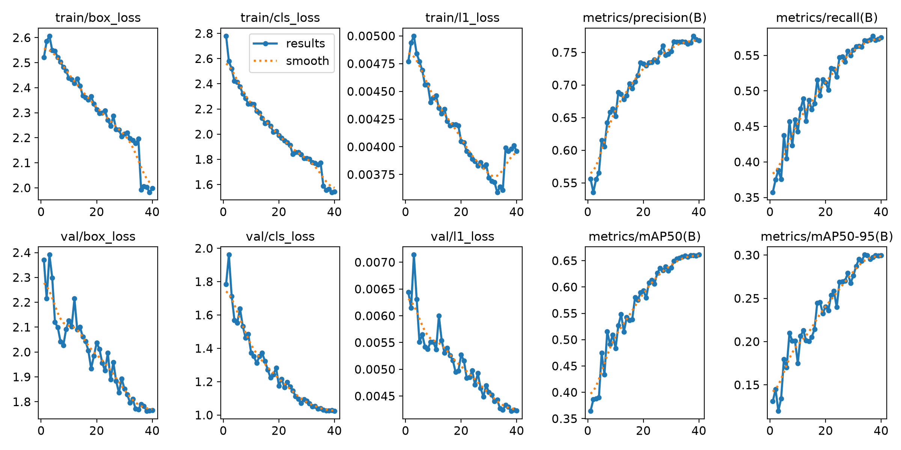

# Training

The detector `models/grass_v1.pt` is YOLO26s fine-tuned to a single `person` class on the dataset mix
described in [DATASETS.md](DATASETS.md). No cloud compute was used: it was trained entirely on a laptop
with an RTX 3050 Laptop GPU (4 GB), 16 GB RAM and about 22 GB of free disk. It is a generalised model, not
one tuned to a specific deployment ([CHALLENGES.md § 2](CHALLENGES.md#2-a-generalised-model-by-design)). The recipe below is sized for that machine; `configs/train.yaml` is the
same recipe for a larger GPU.

## Recipe (`configs/train_laptop.yaml`)

| Setting | Value | Why |
|---|---|---|
| Base model | `yolo26s.pt` (COCO) | NMS-free, small-object-oriented loss, 9.5 M parameters; COCO "person" is a strong starting point |
| Image size | 768 | 960 forces batch 2–3 on 4 GB and doubles epoch time; 768 keeps most small-person detail, and inference uses 1280 px or tiles anyway |
| Batch | 6 (fixed) | batch 8 used 3.45 of 4 GB: too close to out-of-memory for a multi-hour run. Ultralytics AutoBatch picked 1 on this GPU, so it is disabled |
| Epochs / patience | 40 / 10 | fine-tuning converges in 30–40 epochs; early stopping as a guard |
| Optimiser | auto → AdamW, lr 0.002, cosine schedule | Ultralytics' choice for this dataset size |
| Mosaic off for the last | 5 epochs | the usual final-epoch refinement on un-mosaicked images |
| Dataloader workers | 1 | each Windows worker is a separate process holding its own mosaic buffers (~1.5 GB); with 2 workers plus a browser and editor the 16 GB laptop ran out of RAM and the run was killed |
| Checkpoints | every 2 epochs + `last.pt` | resumable after any interruption |
| AMP | on | fp16 training |

### Augmentations (`src/grassdet/augment.py`)

On top of Ultralytics' mosaic, mixup (0.1), cutmix (0.1), HSV jitter, rotation ±10° (lying people),
scale 0.3–1.7 and horizontal flip, ten extra transforms target the two things that change on unseen
footage, **the camera** and **the scene**:

| Transform | p | Simulates |
|---|---|---|
| `GrassOcclusion` (custom) | 0.30 | a band of thin, leaning grass blades in the foreground, coloured from the image's own greenest pixels |
| `ToGray` | 0.15 | thermal / IR / night-vision cameras |
| `CLAHE`, `RandomBrightnessContrast`, `RandomGamma` | 0.1 / 0.3 / 0.2 | dusk, harsh midday sun, auto-exposure |
| `RandomShadow` | 0.15 | dappled shade under trees |
| Motion / defocus / Gaussian blur | 0.2 | hand-held, zoomed or out-of-focus cameras |
| `GaussNoise` | 0.15 | low-light sensor noise |
| `Downscale` | 0.15 | low-resolution sources |
| `ImageCompression` (JPEG 25–90) | 0.3 | messaging-app / CCTV-grade compression |

Boxes are never changed by these transforms, which matches how a person behind grass is labelled
(the box covers the person, not only the visible pixels).

## The grass_v1 run

| | |
|---|---|
| Data | 4,317 train / 1,128 val images (ForestPersons, HIT-UAV, low-altitude UAV, VisDrone 25 %) |
| Duration | 40 epochs, 3.4 h of training (12,118 s), about 5 min per epoch on AC power |
| Interruptions | Run in three chunks with `--resume`: killed once for low system RAM (fixed by `workers: 1`), paused once by choice. No progress lost beyond the epoch in flight. |
| Best checkpoint | epoch 34 (by mAP50-95): combined val mAP50 0.657, mAP50-95 0.300, precision 0.766, recall 0.571 |
| Epoch 1 → best | combined val mAP50 0.364 → 0.657 |



The combined validation set is dominated by VisDrone's tiny city pedestrians (7,482 of 10,730 val boxes),
which is why its absolute mAP looks modest. Per-source scores tell the real story
([RESULTS.md](RESULTS.md)): ForestPersons test mAP50 0.918, HIT-UAV test 0.904.

## Reproduce from scratch

```powershell
hf auth login                                    # once; accept the ForestPersons terms on Hugging Face first
python scripts/fetch_datasets.py --only forestpersons hit_uav uav_lowalt visdrone --delete-raw
python scripts/subset_dataset.py visdrone visdrone_lite --fraction 0.25
python scripts/dedupe_datasets.py --datasets forestpersons hit_uav uav_lowalt visdrone_lite --cross-split-only --apply
python scripts/download_models.py yolo26s.pt yolo11s-pose.pt

python scripts/train.py --config configs/train_laptop.yaml `
    --data forestpersons hit_uav uav_lowalt visdrone_lite --name grass_v1 --allow-noncommercial --resume
copy runs\train\grass_v1\weights\best.pt models\grass_v1.pt
```

Re-running the same `train.py` command after a stop continues from `last.pt`: Ultralytics restores the
epoch, optimiser state and learning-rate schedule, and `train.py` re-applies the custom augmentations
and any memory-related settings (`workers`, `batch`, `cache`, …) from the config.

Practical notes for a laptop:
- Plug in and use the "Best performance" power mode: on battery the GPU is capped at 30 W.
- Keep about 6 GB of RAM free: light browsing is fine; heavy browser sessions or video calls slow the run
  or risk an out-of-memory kill (you then lose only the current epoch).
- `--allow-noncommercial` is required because ForestPersons and VisDrone are non-commercial; the run is
  labelled research-only in its `data.yaml`.

## Training variants

- **Hold-out validation** (does the model generalise to a source it never saw?):
  `train.py --data hit_uav uav_lowalt visdrone_lite --val-on forestpersons --name holdout_fp`
- **Commercial-clean model:** train on `hit_uav uav_lowalt` (plus any commercially licensed additions)
  without `--allow-noncommercial`.
- **Larger GPU:** `configs/train.yaml` is the same recipe at 960 px and batch 16 (≥ 12 GB VRAM).

## Next model (grass_v2)

In order of expected payoff (details in [RESULTS.md § Roadmap](RESULTS.md#7-roadmap-by-expected-payoff)):
1. Thermal: add ForestPersonsIR once access is granted, plus a white-hot ↔ black-hot polarity-inversion
   augmentation. Addresses the thermal-drone failure.
2. Copy-paste compositing: segmented lying/crouching people pasted into person-free grass with foreground
   blades, the closest substitute for staged crawling footage.
3. Hard negatives: animals in grass (BIRDSAI, Snapshot Serengeti) to push false positives back down.
4. 960 px training only if per-size recall shows small people are the remaining problem.
